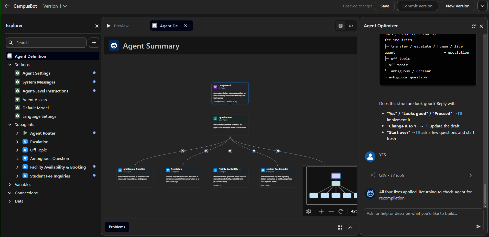

# CampusBot — Salesforce Unlocked Workshop Project

An AI-powered student support agent built using **Salesforce Agentforce / Agent Builder** during the **Salesforce Unlocked** workshop at Amrita Vishwa Vidyapeetham, Nagercoil.

## Architecture Overview

## How CampusBot Works
**CampusBot** acts as a unified campus assistant that greets students, classifies their intent through a central **Agent Router**, and delegates requests to specialized subagents:

* **Agent Router (`agent_router`):** Entry-point agent that welcomes students and routes queries based on detected intent.
* **Facility Booking (`facility_booking`):** Handles availability checks and reservations for classrooms, labs, and sports facilities (`facility`, `room`, `lab`, `sports`, `availability`, `booking`, `reserve`).
* **Fee Inquiries (`fee_inquiries`):** Assists with tuition, hostel fees, exam fees, lab fees, and payment dues (`fee`, `tuition`, `hostel`, `payment`, `dues`, `exam fee`, `lab fee`).
* **Escalation (`escalation`):** Transfers users to a live human agent when requested (`transfer`, `escalate`, `human`, `live agent`).
* **Ambiguous Question (`ambiguous_question`):** Clarifies unclear requests and guides students back to supported campus services.
* **Off Topic (`off_topic`):** Politely redirects out-of-scope queries back to relevant campus topics.

## Repository Contents
* `README.md` — Project overview, routing logic, and architecture documentation.
* `image.png` — Visual overview of the CampusBot Agent Summary and Optimizer routing logic.
* `CampusBot-definition.yaml` — Exported agent script and routing configuration.

## Author
* **Name:** Rudra Kumar
* **Roll Number:** `nc.sc.u4cse24228`
* **Institution:** Amrita Vishwa Vidyapeetham, Nagercoil
